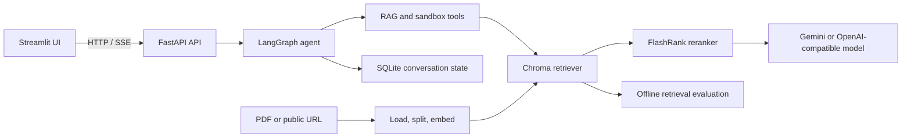

# Stream-Agent RAG Demo

[](https://github.com/Mootra/langchain-chat-app/actions/workflows/offline-tests.yml)

A focused Python demo for building a stateful LLM assistant with FastAPI, Streamlit, LangGraph, tool calling, PDF/web ingestion, cited RAG responses, and offline retrieval evaluation.

This repository demonstrates application engineering around existing model and retrieval libraries. It does not claim to implement a foundation model, embedding model, or vector database from scratch.

## What the project demonstrates

- A FastAPI backend with synchronous and Server-Sent Events chat endpoints.
- A Streamlit UI for model configuration, chat, tool events, and PDF upload.
- A LangGraph ReAct agent with SQLite-backed conversation state.
- PDF and public-web ingestion into a Chroma vector store.
- Hugging Face embeddings, similarity retrieval, and optional FlashRank reranking.
- Stable source citations and raw retrieved documents preserved as tool artifacts.
- An offline evaluation harness for Hit Rate@K, mean reciprocal rank, and expected-source recall.
- Upload path/size validation, public-URL validation, secret isolation, and dependency-light CI tests.

## Architecture



Important code locations:

```text
backend/main.py                  FastAPI endpoints and upload boundary
backend/agent_service.py         LangGraph agent, tools, and conversation state
backend/langchain_qa_backend.py  ingestion, vector store, reranking, RAG chain
backend/rag/formatting.py        cited answer formatting
backend/rag/evaluation.py        dependency-light retrieval metrics
backend/runtime_config.py        runtime paths, origins, and upload policy
backend/url_policy.py            public HTTP/HTTPS URL validation
frontend/app.py                  Streamlit interface
tools/evaluate_retrieval.py      evaluation CLI using the current vector store
tests/                            offline unit and source-contract tests
```

## Local setup

Python 3.11 or 3.12 is recommended. The embedding and reranking dependencies are sizeable, so the first installation and first embedding-model load can take several minutes.

Windows PowerShell:

```powershell
python -m venv .venv
.\.venv\Scripts\Activate.ps1
python -m pip install --upgrade pip
python -m pip install -r requirements.txt
Copy-Item backend\.env.example backend\.env
notepad backend\.env
```

At minimum, configure `GOOGLE_API_KEY` for the default Gemini provider. Alternatively, set `LLM_PROVIDER=openai_compatible` and configure the corresponding base URL, model, and API key.

Never commit `backend/.env`. The repository tracks only `backend/.env.example`.

## Run the application

Start the backend from the repository root:

```powershell
.\.venv\Scripts\Activate.ps1
python -m uvicorn backend.main:app --host 127.0.0.1 --port 8000 --reload
```

Start the frontend in a second terminal:

```powershell
.\.venv\Scripts\Activate.ps1
$env:BACKEND_URL='http://127.0.0.1:8000'
python -m streamlit run frontend/app.py
```

The backend health endpoint is available at `http://127.0.0.1:8000/` and the Streamlit UI defaults to `http://127.0.0.1:8501/`.

Docker Compose is also available:

```powershell
docker compose up --build
```

## Offline tests

The core security, formatting, evaluation, and frontend-contract tests do not call a model provider and do not download embedding models:

```powershell
python -m unittest discover -s tests -v
python -m compileall -q backend tests tools
```

GitHub Actions runs the same checks and rejects tracked `.env`, bytecode, database, and cache files.

## Retrieval evaluation

1. Index the documents that will form the evaluation corpus.
2. Copy `evaluation/rag_cases.example.jsonl` and replace the sample entries with real questions and expected source names.
3. Run the evaluator without calling the chat model:

```powershell
python tools/evaluate_retrieval.py --cases evaluation/rag_cases.jsonl --k 5
```

Example output shape:

```json
{
  "evaluated_cases": 20,
  "hit_rate_at_k": 0.85,
  "mean_reciprocal_rank": 0.71,
  "expected_source_recall_at_k": 0.78
}
```

These numbers are an output example, not a claimed benchmark. Only report metrics produced from a committed dataset and a reproducible vector-store snapshot.

## Security boundaries

- Only PDF uploads are accepted, with a configurable maximum byte size.
- Upload filenames cannot contain directory components or unsupported characters.
- URL ingestion permits only HTTP/HTTPS targets that resolve exclusively to public IP addresses.
- Localhost, private, loopback, link-local, reserved, and credentialed URLs are rejected.
- Provider keys belong in `backend/.env` or deployment secrets, never in Git.
- The synchronous agent endpoint logs provider failures server-side and returns a generic client error.

This remains a demo, not a production multi-tenant service. It does not yet provide authentication, per-user vector-store isolation, rate limiting, or a full end-to-end test against live providers.

## Current limitations and next work

- Add authenticated users and isolate chat/vector data per account.
- Replace user-supplied API keys in request bodies with server-managed provider profiles.
- Commit a real retrieval evaluation dataset and publish reproducible results.
- Add integration tests with fake model and embedding implementations.
- Record request latency, retrieval depth, tool failures, and provider error rates.
