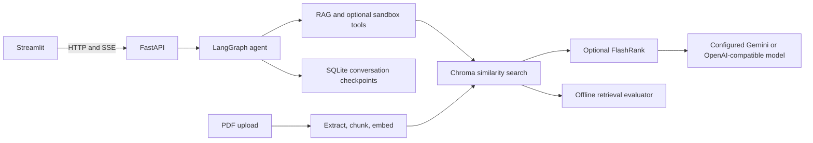

# DocuLens — Intelligent Knowledge & Research Assistant

[](https://github.com/Mootra/TraceRAG/actions/workflows/offline-tests.yml)

DocuLens is a local document-question-answering demonstration built on the existing [Mootra/TraceRAG](https://github.com/Mootra/TraceRAG) repository. It combines PDF ingestion, semantic retrieval, optional reranking, a LangGraph tool-using assistant, source citations, conversation persistence, and offline retrieval evaluation.

## What it demonstrates

- FastAPI backend and Streamlit interface with server-sent chat events.
- LangGraph ReAct agent with SQLite checkpointing by conversation ID.
- PDF ingestion into Chroma using Hugging Face embeddings and page metadata.
- Similarity search, configurable relevance floor, optional FlashRank reranking, and excerpt citations.
- Public URL ingestion with URL validation in the existing ingestion tool.
- Health and document inventory APIs, plus a retrieval evaluation page.
- An original sample PDF and reproducible retrieval questions.

The application composes existing AI and vector-store libraries; it does not implement a foundation model, embedding model, or vector database from scratch. It is a local technical demo, not a production multi-tenant service.

## Architecture



See [docs/ARCHITECTURE.md](docs/ARCHITECTURE.md) for component details.

## Repository map

```text
backend/main.py                  FastAPI routes and upload boundary
backend/agent_service.py         LangGraph agent, tools, and SQLite state
backend/langchain_qa_backend.py  PDF/URL ingestion, Chroma, retrieval and RAG
backend/rag/formatting.py        Evidence selection and citation formatting
backend/rag/evaluation.py        Dependency-light retrieval metrics
backend/runtime_config.py        Paths, upload policy, and CORS settings
backend/url_policy.py            Public HTTP/HTTPS URL validation
frontend/app.py                  Streamlit navigation, upload, chat, evaluation
frontend/style.css               Application styling
demo/                            Original sample source and PDF
evaluation/                      Demonstration retrieval cases
docs/                            Architecture, implementation, and demo guides
scripts/                         Windows PowerShell startup helpers
tests/                           Offline unit and source-contract tests
```

## Setup on Windows

Python 3.11 or 3.12 is recommended. Embedding and reranking packages may take time to install and download their first model.

```powershell
Set-ExecutionPolicy -Scope Process -ExecutionPolicy Bypass
py -3.11 -m venv .venv
.\.venv\Scripts\Activate.ps1
python -m pip install --upgrade pip
python -m pip install -r requirements.txt
if (-not (Test-Path backend\.env)) { Copy-Item backend\.env.example backend\.env }
notepad backend\.env
```

Set `GOOGLE_API_KEY` in `backend/.env` for Gemini. Alternatively, set `LLM_PROVIDER=openai_compatible`, `OPENAI_BASE_URL`, `OPENAI_MODEL`, and `OPENAI_API_KEY`. Provider credentials are read by the backend; the frontend does not collect them or include them in chat requests. Never commit `backend/.env`.

Optional retrieval tuning is also available in `backend/.env`: `RAG_MIN_RELEVANCE_SCORE` (default `0.25`), `RAG_RETRIEVAL_K` (default `20`), `RAG_RERANK_TOP_N` (default `10`), `RAG_CHUNK_SIZE` (default `1000`), `RAG_CHUNK_OVERLAP` (default `200`), `RERANK_ENABLED` (default `true`), and `MAX_WEB_BYTES` (default 2 MiB).

### Start services

In separate PowerShell terminals at the repository root:

```powershell
Set-ExecutionPolicy -Scope Process -ExecutionPolicy Bypass
.\.venv\Scripts\Activate.ps1
.\scripts\start_backend.ps1
```

```powershell
Set-ExecutionPolicy -Scope Process -ExecutionPolicy Bypass
.\.venv\Scripts\Activate.ps1
.\scripts\start_frontend.ps1
```

Open <http://localhost:8501>. `scripts/start_demo.ps1` checks configuration and ports, then starts both services in the background. The root-level `docker compose up --build` workflow is also available.

## Demo workflow

1. Open **Knowledge Base** and download `DocuLens_Demo.pdf`, or locate it at `demo/DocuLens_Demo.pdf`.
2. Upload the PDF from the sidebar and wait for the backend to confirm indexing.
3. Ask: “Explain how RAG works and identify the role of embeddings, vector search and reranking.”
4. Inspect the cited excerpts and expand the agent execution panel.
5. In **Evaluation**, run the included cases against the indexed vector store.

The sample note is original project writing. Metrics are displayed only after the evaluator actually runs; a four-question single-document dataset is illustrative and is not a broad benchmark. More detail and recovery steps are in [docs/DEMO_GUIDE.md](docs/DEMO_GUIDE.md).

## API routes

| Method | Path | Purpose |
| --- | --- | --- |
| GET | `/` | Backward-compatible basic health response |
| GET | `/health` | Configuration state; provider reachability is not checked |
| GET | `/documents` | Indexed source metadata and chunk counts |
| POST | `/upload_file` | Validate and index a PDF |
| POST | `/chat_agent` | Non-streaming agent response |
| POST | `/chat/stream` | SSE text and actual tool events |
| POST | `/evaluation/run` | Evaluate bundled cases against the local index |

## Evaluation and tests

Run the demo evaluation after indexing its PDF:

```powershell
python tools/evaluate_retrieval.py --cases evaluation/rag_cases.demo.jsonl --k 5
```

Offline checks do not call a paid provider:

```powershell
python -m unittest discover -s tests -v
python -m compileall -q backend tests tools
```

## Security and limitations

- PDF uploads are limited by `MAX_UPLOAD_BYTES`; filenames are validated before writing.
- The URL policy rejects credentialed URLs and non-public IP destinations. Review redirect behavior before exposing URL ingestion to untrusted users.
- Secrets stay in backend configuration and are not returned by `/health`.
- `.dockerignore` excludes local `.env`, database, upload, and cache files from image builds.
- `/health` reports configured state only. It does not probe provider reachability; vector-store state indicates whether local index files are present.
- Authentication, per-user vector isolation, production rate limiting, and enterprise compliance are not implemented.
- Live provider integration and model-backed ingestion require the corresponding installed dependencies, model downloads, and credentials.

## Attribution

This project is based on [Mootra/TraceRAG](https://github.com/Mootra/TraceRAG), licensed under MIT. Its `LICENSE` and Git history are retained. DocuLens changes are described in [docs/IMPLEMENTATION.md](docs/IMPLEMENTATION.md); the original project and contributors remain credited for the base application.
