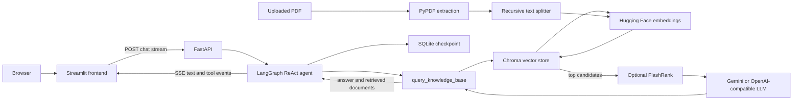

# DocuLens architecture

DocuLens extends the existing TraceRAG implementation. The original
FastAPI, Streamlit, LangGraph, LangChain, Chroma, and SQLite boundaries remain
the basis of the application.

## Request and data flow

## Components

- **Streamlit (`frontend/app.py`)** provides the Research Assistant, Knowledge
  Base, Evaluation, and Settings views. It sends chat messages and PDFs to the
  backend. Provider credentials are not loaded into or sent from the frontend.
- **FastAPI (`backend/main.py`)** preserves `/`, `/chat_agent`, `/chat/stream`,
  and `/upload_file`; it also exposes `/health`, `/documents`, and
  `/evaluation/run`. Upload names and byte limits are checked before files are
  written.
- **LangGraph (`backend/agent_service.py`)** runs a ReAct agent with the
  knowledge-base tool and optional sandbox tools. SQLite checkpointing uses the
  supplied conversation ID. SSE emits final agent text, tool start/end events,
  a status message, and a generic failure event when execution fails.
- **Ingestion (`backend/langchain_qa_backend.py`)** extracts PDF pages, splits
  text into overlapping chunks, adds source/page/document/chunk metadata, and
  indexes them in Chroma. Reingesting the same source replaces the prior
  chunks for that source.
- **Retrieval and citations** use Chroma similarity scores and a configurable
  minimum relevance score (`RAG_MIN_RELEVANCE_SCORE`, default `0.25`), bounded
  top K, and chunk sizes from backend environment variables. Empty evidence
  returns the explicit insufficient-evidence response without calling the
  answer model. FlashRank can reorder retrieved candidates; set
  `RERANK_ENABLED=false` to disable it. Source labels and previews are built
  from actual retrieved document metadata.
- **Public web ingestion** validates every HTTP redirect, rejects non-public
  destinations, uses connect/read timeouts, restricts content types, and caps
  the response body (`MAX_WEB_BYTES`, default 2 MiB). This is a single-page
  ingestion path and does not crawl a site.
- **Evaluation** (`backend/rag/evaluation.py` and
  `tools/evaluate_retrieval.py`) computes Hit Rate@K, MRR, and expected-source
  recall from the current index. It does not call the answer model. The UI
  invokes the same metrics using `evaluation/rag_cases.demo.jsonl`.
- **Health reporting** identifies configured provider/model and local vector
  files. It does not call the provider or open the vector store to assert
  reachability. `reachability: not_checked` is intentional, and the vector
  state says only whether local vector-store files are present.

## Configuration and state

`backend/main.py` loads `backend/.env` before creating runtime paths. The
default provider is Gemini; `LLM_PROVIDER=openai_compatible` selects the
OpenAI-compatible provider. Keys remain server-side. Chroma and SQLite live
under `DATA_DIR`; PDF uploads are staged under `UPLOAD_DIR`. The defaults are
resolved relative to the backend package.

The application is a local demo. Conversations and vector data are shared by
the local service; no authentication or per-user storage isolation is
implemented.
